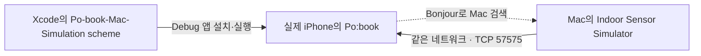

# 다른 Mac에서 Po:book 실제 iPhone ↔ Mac 시뮬레이터 설정하기

작성 기준: 2026-11-04. 이 파일만 전달받은 사람이나 AI가 새 Mac에서 설치·연결·검증을 이어갈 수 있도록 작성했다.

## 1. 목표와 작업 범위

**Mac의 Indoor Sensor Simulator에서 가상 사용자를 움직이면, 실제 iPhone의 Po:book 앱이 그 위치·층·방향을 받아 지도에 표시하게 한다.**

- Mac에서 실행: `IndoorPositioningSimulator` 저장소의 **Indoor Sensor Simulator**.
- iPhone에서 실행: `postech-library` 저장소의 **Po:book**, Debug 빌드.
- Xcode 역할: iPhone 앱 빌드·개발 서명·설치·테스트 모드로 실행.
- 데이터 연결: 같은 로컬 네트워크에서 TCP `57575`. Mac 자동 검색은 Bonjour `_indoor-sim._tcp`.
- USB 케이블: 처음 기기를 연결하고 앱을 설치·디버깅할 때 사용한다. 이 구현의 위치 데이터 전달은 로컬 네트워크를 사용한다.
- 이번 연결은 앱이 선택한 Debug 위치 공급자에 데이터를 넣는다. 실제 iPhone의 시스템 GPS나 다른 앱의 위치를 바꾸는 기능은 아니다.



### 다음 AI에게 전달할 작업 요청

> 이 문서를 기준으로 다른 Mac과 실제 iPhone에 Po:book의 Mac 시뮬레이터 연결 환경을 설정해 주세요. 먼저 각 작업 경로의 AGENTS.md와 현재 Git 변경 사항을 확인하세요. 두 저장소의 `feat/physical-device-simulation` 브랜치를 사용하고, 기존 작업을 보존하세요. 기본 흐름은 소스 받기 → Mac 앱 빌드 → 같은 도서관 도면 열기 → iPhone 개발 서명 → `Po-book-Mac-Simulation`으로 실행 → 로컬 네트워크 권한 허용 → 실제 위치·층 수신 확인입니다. 단순 설치 성공이나 TCP 접속만으로 전체 완료를 선언하지 말고, 실제 iPhone의 위치 이동·층 변경·재연결 결과를 구분해서 보고해 주세요. 기기 잠금 해제와 화면의 사용자 확인이 필요하면 그 단계를 명확하게 안내하세요. 일반적인 설정 작업을 임의의 기능 개발이나 저장소 병합으로 확대하지 마세요.

## 2. 사용할 저장소와 코드 기준

| 구분 | 저장소 | 사용할 브랜치 | 기능 구현 커밋 |
| --- | --- | --- | --- |
| Mac 컨트롤러 | <https://github.com/adap-c6-fingerprint/IndoorPositioningSimulator> | `feat/physical-device-simulation` | `899a7e3432b4c1c7c4d63a1fffbd7301a6bfa08e` |
| iPhone 앱 | <https://github.com/adap-c6-fingerprint/postech-library> | `feat/physical-device-simulation` | `0c3b170356bc8711ce2fc68d25bb415673b3e0d8` |

기능은 위 브랜치에 업로드되어 있다. 이 문서만 보고 `main`이나 `dev`에 이미 병합됐다고 가정하지 않는다. 문서 추가로 브랜치의 최신 커밋은 위 기능 구현 커밋보다 뒤일 수 있다.

이 문서의 명령은 새 Mac에서 두 저장소를 다음 경로에 받는 경우를 기준으로 한다. 사용자 이름이나 기존 개발자의 절대 경로를 복사할 필요는 없다.

```text
~/Developer/indoor-qa/
├── IndoorPositioningSimulator/
└── postech-library/
```

## 3. 준비물과 버전

| 준비물 | 확인할 내용 |
| --- | --- |
| Mac | 사용할 Xcode가 지원하는 macOS 버전 |
| Xcode 전체 앱 | 기존 검증 환경은 **Xcode 27.2**. Command Line Tools만 설치한 상태로 진행하지 않는다. |
| 실제 iPhone | Po:book 앱 타깃의 최소 버전은 **iOS 26.0**. 기존 기기 빌드·설치 확인은 **iOS 27.2**에서 수행했다. |
| Apple Account / 개발 팀 | 새 Mac의 Xcode에서 로그인하고, 앱을 기기에 설치할 수 있는 팀 선택 |
| GitHub 접근 권한 | 두 저장소를 내려받을 수 있는 계정 |
| 네트워크 | Mac과 iPhone이 서로 통신할 수 있는 같은 Wi-Fi 또는 같은 로컬 네트워크 |
| USB 케이블 | 첫 연결과 개발 기기 설정에 사용 |

Apple의 2026-11-04 지원 표에서 Xcode 27.2의 실행 조건은 macOS Tahoe 26.6 이상이다. 설치 전 [Xcode의 현재 지원 환경](https://developer.apple.com/xcode/system-requirements)을 확인한다. Mac 컨트롤러 자체의 최소 macOS 15 조건만 보고 전체 개발 환경을 판단하지 않는다.

지도와 가상 위치 수신만 확인할 때는 도서 API 토큰이 필요하지 않다. 책 검색·추천·소장 조회까지 검증할 때만 11절의 토큰 설정을 추가한다.

## 4. 새 Mac의 Xcode 준비

1. Xcode 전체 앱을 설치하고 한 번 실행한다.
2. 첫 실행의 사용권 동의와 추가 구성요소 설치를 사용자가 완료한다.
3. Xcode 설정의 **Locations → Command Line Tools**에서 사용할 Xcode를 선택한다.
4. **Apple Accounts** 또는 해당 버전의 계정 설정 메뉴에서 본인 Apple Account로 로그인한다.
5. iPhone 앱을 빌드할 iOS 플랫폼 지원을 설치한다. 실제 기기 연결만 할 때는 별도의 iPhone Simulator를 부팅할 필요가 없다. 자동 테스트를 실행하려면 해당 iOS Simulator 런타임을 추가한다.

터미널에서 확인한다.

```sh
xcodebuild -version
swift --version
xcode-select -p
```

마지막 경로는 선택한 Xcode 앱 내부의 `Contents/Developer`를 가리켜야 한다. `/Library/Developer/CommandLineTools`라면 Xcode 설정에서 다시 선택한다.

## 5. 소스 받기

아래 명령은 아직 해당 폴더가 없는 새 작업 디렉터리에서 실행한다. 기존 checkout에 변경 사항이 있으면 먼저 `git status`로 확인하고, 그 위에 강제 초기화하지 않는다.

```sh
mkdir -p ~/Developer/indoor-qa
cd ~/Developer/indoor-qa

git clone --branch feat/physical-device-simulation https://github.com/adap-c6-fingerprint/IndoorPositioningSimulator.git
git clone --branch feat/physical-device-simulation https://github.com/adap-c6-fingerprint/postech-library.git
```

접근 권한 오류가 나면 저장소를 볼 수 있는 GitHub 계정의 인증을 먼저 해결한다.

브랜치와 기능 커밋 포함 여부를 확인한다.

```sh
git -C ~/Developer/indoor-qa/IndoorPositioningSimulator branch --show-current
git -C ~/Developer/indoor-qa/postech-library branch --show-current

git -C ~/Developer/indoor-qa/IndoorPositioningSimulator merge-base --is-ancestor 899a7e3432b4c1c7c4d63a1fffbd7301a6bfa08e HEAD
git -C ~/Developer/indoor-qa/postech-library merge-base --is-ancestor 0c3b170356bc8711ce2fc68d25bb415673b3e0d8 HEAD
```

앞의 두 명령은 모두 `feat/physical-device-simulation`을 출력해야 한다. 뒤의 두 명령은 정상일 때 출력 없이 종료 코드 0을 반환한다.

설정을 수행하는 AI는 내려받은 저장소의 `AGENTS.md`와 상위 경로의 지침을 읽는다. `postech-library`에는 기본 역할을 코드 리뷰로 제한하는 지침이 있으므로 현재 사용자 요청의 범위와 구분한다. 이 문서는 기존 구현의 환경 설정·실행 안내이며, 별도의 기능 수정 권한을 새로 부여하지 않는다.

## 6. Mac 컨트롤러 빌드·실행

```sh
cd ~/Developer/indoor-qa/IndoorPositioningSimulator
./Scripts/build-app.sh
open '.build/Indoor Sensor Simulator.app'
```

빌드 스크립트는 실행 파일 빌드, 앱 번들 구성, 로컬 서명과 검증까지 수행한다. 완성된 앱은 저장소의 `.build/Indoor Sensor Simulator.app`에 있다.

확인할 내용:

- **Indoor Sensor Simulator** 창이 열린다.
- 처음 실행한 Mac에는 아직 도면이 등록되지 않았을 수 있다.
- 업데이트 전 버전이 열려 있다면 먼저 저장할 시나리오를 보관하고 종료한 뒤 새 앱을 연다. 같은 포트의 컨트롤러를 중복 실행하지 않는다.
- Mac에 로컬 네트워크 접근 요청이나 해당 앱의 수신 연결 허용 요청이 나타나면 연결 테스트에 필요한 허용을 진행한다.

### 같은 도서관 도면 열기

Po:book 저장소에는 도서관 IMDF가 이미 포함돼 있다. Mac 컨트롤러의 **도서관** 버튼 또는 **IMDF 열기…**에서 아래 폴더를 선택한다.

```text
~/Developer/indoor-qa/postech-library/fingerprint-library/Resources/IndoorMaps/POSTECHLibrary/IMDFData
```

파일 선택창에서 `⌘⇧G`를 누르면 경로를 입력해 이동할 수 있다. 개별 `level.geojson` 파일이 아니라 그 파일이 들어 있는 `IMDFData` 폴더를 선택한다.

지도·층 목록·초록색 가상 사용자가 보이는지 확인하고, 오른쪽 **테스트 모드 → Wi-Fi 위치 기반 측위**를 **끈다**.

Po:book은 현재 `groundTruth` 모드의 가상 위치를 받는다. 토글을 켠 `radioBased` 모드는 수용하지 않고 모드 전환 안내를 표시한다.

선택한 테스트 모드는 해당 실행 환경에 저장되어 재실행 후에도 유지된다. 처음 실행하는 환경에서는 Po:book에 연결하기 전에 토글을 한 번 끈다.

이 Mac의 도면 등록 경로는 처음 한 번 설정해야 한다. 다른 Mac의 저장된 폴더 경로가 자동으로 이전되지는 않는다.

## 7. 실제 iPhone 개발 실행 준비

1. iPhone 잠금을 해제하고 Mac과 USB로 연결한다.
2. iPhone에 이 컴퓨터를 신뢰할지 묻는 화면이 나오면 사용자가 확인한다.
3. Xcode에서 기기가 인식되는지 확인한다. Xcode 27 계열에서는 **Device Hub**, 이전 버전에서는 **Devices and Simulators** 등 해당 버전의 기기 관리 화면을 사용한다.
4. iPhone의 **설정 → 개인정보 보호 및 보안 → 개발자 모드**를 활성화한다. 요청되는 재시동과 재확인을 완료한다.
5. 개발자 모드 항목이 보이지 않으면 Xcode와 기기를 먼저 연결·페어링한다.
6. 기기 준비가 끝날 때까지 기다리고 iPhone을 잠금 해제 상태로 둔다.

Apple 안내: [기기에서 개발자 모드 활성화](https://developer.apple.com/documentation/xcode/enabling-developer-mode-on-a-device), [실제 기기에서 앱 실행](https://developer.apple.com/documentation/xcode/running-your-app-on-simulated-or-physical-devices).

### Po:book 개발 서명 설정

프로젝트를 연다.

```sh
open ~/Developer/indoor-qa/postech-library/fingerprint-library.xcodeproj
```

Xcode에서 다음 순서로 설정한다.

1. 왼쪽 프로젝트 파일을 선택한다.
2. **TARGETS → fingerprint-library → Signing & Capabilities**로 이동한다.
3. **Automatically manage signing**을 켠다.
4. **Team**을 이 Mac에서 사용할 본인 또는 팀의 개발 계정으로 선택한다. 저장소에 기록된 다른 개발자의 Team ID를 그대로 사용할 수 있다고 가정하지 않는다.
5. 서명 오류가 없고 실제 iPhone을 실행 대상으로 선택할 수 있는지 확인한다.

현재 앱의 Bundle Identifier는 `com.youngmin.fingerprint-library`다. 해당 식별자를 사용할 권한이 없다는 오류가 나면 팀 권한을 확인한다. 개인 테스트를 위해 별도 식별자가 필요하다면 사용자와 확인한 고유 식별자를 사용하고, 기존 앱과 별도 설치본임을 기록한다.

두 저장소 사이에 로컬 Swift Package 의존성을 추가할 필요는 없다. Po:book에는 필요한 위치 프레임을 읽는 TCP 어댑터가 이미 구현돼 있다.

## 8. 테스트 scheme으로 iPhone 앱 실행

Xcode 상단에서 아래와 같이 선택한다.

| 항목 | 선택값 |
| --- | --- |
| Scheme | **Po-book-Mac-Simulation** |
| Run destination | 연결한 **실제 iPhone 이름** |
| Run의 Build Configuration | **Debug** |

이후 **Product → Scheme → Edit Scheme… → Run → Arguments → Environment Variables**를 확인한다.

| 변수 | 값 | 기본 활성화 상태 |
| --- | --- | --- |
| `INDOOR_POSITION_SOURCE` | `simulation` | 켬 |
| `INDOOR_SIMULATOR_HOST` | `your-mac.local`이라는 예시값이 들어 있음 | **끔** — 자동 검색을 먼저 사용할 때 유지 |

`your-mac.local`은 실제 접속 주소가 아니라 예시값이다. 자동 검색 단계에서는 이 행을 켜지 않는다.

1. Mac과 iPhone을 같은 Wi-Fi에 연결한다.
2. Mac 컨트롤러가 실행 중이고 도서관 지도와 `groundTruth` 모드가 준비됐는지 확인한다.
3. Xcode에서 `⌘R`을 누른다.
4. 최초 Swift Package 의존성 다운로드와 빌드가 끝날 때까지 기다린다.
5. 실제 iPhone에서 Po:book이 실행되면 지도 화면으로 이동한다.
6. 로컬 네트워크 접근 요청을 허용한다.

허용을 거부했거나 다시 확인하려면 **iPhone 설정 → 개인정보 보호 및 보안 → 로컬 네트워크 → Po:book**을 확인한다. 앱이 네트워크 연결을 시도한 뒤 목록에 나타난다. Mac에서도 해당 권한이 거절돼 있으면 **시스템 설정 → 개인정보 보호 및 보안 → 로컬 네트워크**에서 확인한다. [Apple 로컬 네트워크 안내](https://developer.apple.com/documentation/technotes/tn3179-understanding-local-network-privacy)

실제 iPhone 연결에는 Mac 앱의 **Core Location도 주입** 설정이 필요하지 않다. 해당 설정과 **Core Location 대상**의 Simulator 선택은 Xcode의 가상 기기에 대한 기능이다.

## 9. 성공 여부를 실제 화면으로 확인

아래 항목을 각각 관찰한다.

1. **연결:** Mac의 **센서 브리지** 표시가 1개 이상의 앱 연결로 바뀐다. 다른 테스트 앱도 연결돼 있으면 숫자가 더 클 수 있다.
2. **위치 수신:** 실제 iPhone 지도에 가상 위치가 표시된다.
3. **이동:** Mac의 지도 영역을 클릭하고 방향키나 화면 방향 버튼으로 가상 사용자를 이동한다. iPhone의 위치 표시도 따라 움직여야 한다.
4. **층 변경:** Mac에서 계단·엘리베이터 등 수직 이동이 가능한 영역으로 이동한 뒤 **위층 / 아래층**을 사용한다. iPhone의 위치 층과 지도도 새 위치에 맞게 반영되는지 확인한다.
5. **재연결:** 앱을 비활성화했다가 다시 열거나, 상태를 보관한 Mac 컨트롤러를 종료·재실행한 뒤 위치가 다시 수신되는지 확인한다.

센서 브리지 연결 수는 TCP 접속의 근거다. 같은 도면인지, 프레임이 수용됐는지, 실제 지도에 표시되는지까지 보장하지 않으므로 2~5번을 생략하지 않는다.

### 앱을 다시 실행할 때 주의할 동작

- 실제 iPhone의 기본 실행은 실제 Core Location을 사용한다.
- 실제 iPhone의 Debug 빌드에 `INDOOR_POSITION_SOURCE=simulation`을 전달했을 때 Mac 위치 공급자를 선택한다.
- 앱을 완전히 종료한 뒤 홈 화면 아이콘으로 새로 실행하면 Xcode scheme의 환경 변수가 전달되지 않는다. Mac 연동 테스트는 **Po-book-Mac-Simulation → 실제 iPhone → ⌘R**로 시작한다.
- 테스트 중 연결이 끊겼다고 실제 위치로 자동 전환하지 않는다. 가상 위치를 비우고 Mac에 다시 연결한다.
- Release에서는 이 TCP 위치 공급 코드를 포함하지 않는다. 이 설정을 TestFlight/App Store 설치본에 그대로 적용할 수 있다고 가정하지 않는다.

## 10. 자동 검색이 안 될 때: Mac 주소 직접 지정

Bonjour 검색이 제한된 네트워크에서는 Mac 주소를 직접 지정할 수 있다.

1. Mac 컨트롤러의 **iPhone 연결 → 직접 연결 주소**를 확인한다. 예: `My-Mac.local`.
2. `.local` 이름도 해석되지 않는 환경이면 Mac의 현재 Wi-Fi 세부정보에서 IP 주소를 확인한다. 예: `192.168.0.10`.
3. Xcode의 **Po-book-Mac-Simulation → Edit Scheme → Run → Arguments → Environment Variables**로 이동한다.
4. `INDOOR_SIMULATOR_HOST`를 활성화하고 실제 Mac 호스트 이름 또는 IP 주소를 입력한다.
5. Xcode에서 앱을 중지하고 `⌘R`로 다시 실행한다. 실행 환경 설정은 이미 실행 중인 프로세스에 자동 반영되지 않는다.

예시 설정:

| 변수 | 값 | 활성화 |
| --- | --- | --- |
| `INDOOR_POSITION_SOURCE` | `simulation` | 켬 |
| `INDOOR_SIMULATOR_HOST` | `192.168.0.10` | 켬 |

`192.168.0.10`은 예시다. 새 Mac의 실제 주소로 바꾼다. 호스트 값에는 `http://`나 `:57575`를 붙이지 않는다. `127.0.0.1`을 입력하면 실제 iPhone 자신에게 연결하므로 Mac에 연결되지 않는다.

기본 포트는 `57575`라서 포트 변수를 추가할 필요가 없다. `INDOOR_SIMULATOR_PORT`는 클라이언트의 포트를 바꾸는 선택 설정이며, 상대 서버도 같은 포트를 사용하도록 별도 구성했을 때만 사용한다. 이 변수만 바꾼다고 Mac 앱의 서버 포트가 바뀌지는 않는다. 활성화한 경우 빈 문자열·0·65536 이상은 유효하지 않다.

같은 Wi-Fi 이름을 사용하더라도 게스트 네트워크나 기관 네트워크가 기기 간 통신을 차단하면 직접 IP로도 연결되지 않을 수 있다. 기기 간 통신이 허용된 사설 네트워크에서 확인한다.

## 11. 책 검색까지 확인할 때만: 개발 중계 토큰

지도·가상 위치 연결 검증이 끝난 뒤 실제 책 검색 등이 필요한 경우에만 설정한다.

```sh
cd ~/Developer/indoor-qa/postech-library
cp Secrets.example.xcconfig Secrets.xcconfig
```

위 복사는 `Secrets.xcconfig`가 아직 없는 새 환경에서 한 번만 한다. 이미 설정한 파일이 있다면 덮어쓰지 않는다.

`Secrets.xcconfig`의 `POBOOK_RELAY_TOKEN_DEVELOPMENT` 값에 팀에서 발급받은 **개발 중계 접근 토큰**을 입력한다. 실제 토큰은 이 문서에 포함하지 않는다.

- Debug 빌드는 토큰 없이 가능하지만 실제 API 조회에는 토큰이 필요하다.
- 원 제공사의 API 키를 앱에 넣지 않는다.
- `Secrets.xcconfig`는 `.gitignore` 대상이다. 공유 예시 파일이나 커밋에 실제 토큰을 넣지 않는다.
- 토큰을 받은 뒤 앱을 다시 빌드·실행해 API 조회를 확인한다.

## 12. 문제가 생겼을 때

| 증상 | 확인 순서 |
| --- | --- |
| `Po-book-Mac-Simulation` scheme이 없음 | 앱 저장소 브랜치 확인 → `fingerprint-library.xcodeproj/xcshareddata/xcschemes/Po-book-Mac-Simulation.xcscheme` 존재 확인 → 프로젝트 다시 열기 |
| Xcode에서 Team/프로파일 오류 | 본인 Apple Account 로그인 → 앱 타깃의 Team → Automatically manage signing → Bundle Identifier 권한 순으로 확인 |
| iPhone을 선택할 수 없음 | USB·신뢰·기기 페어링·개발자 모드·iOS/Xcode 지원 버전·기기 준비 상태 확인 |
| 설치됐지만 `Locked`로 실행 실패 | iPhone 잠금을 사용자가 해제한 뒤 다시 실행. 설치 성공과 실행 성공을 구분 |
| 센서 브리지 0개 | 실제 iPhone의 Debug scheme과 `simulation` 환경 변수 → 지도 화면 진입 → 로컬 네트워크 허용 → 같은 네트워크 → 직접 Mac 주소 순으로 확인 |
| 연결됐지만 위치가 표시되지 않음 | 양쪽 모두 같은 도서관 IMDF인지, Mac의 Wi-Fi 위치 기반 측위가 꺼져 있는지 확인 |
| `radioBased` 또는 Wi-Fi 모드 전환 안내 | Mac의 Wi-Fi 위치 기반 측위를 꺼 `groundTruth`로 전환 |
| 다른 건물 위치·층 오류 | C5와 POSTECHLibrary 도면을 혼용하지 않았는지 확인. 표시 층 번호와 IMDF ordinal을 혼동하지 않음 |
| Mac 서버 시작 오류·포트 충돌 | 컨트롤러 중복 실행 여부와 TCP 57575 점유 확인. 이전 버전을 종료한 뒤 원하는 새 버전 실행 |
| 새 Mac 창에서 움직여도 블루닷은 고정 | 이전 설치본이 백그라운드에서 57575를 점유하는지 확인. 창 닫기만으로 앱이 종료되지 않을 수 있으므로 `⌘Q`로 기존 앱을 종료하고 Xcode 실행본도 중지한 뒤 컨트롤러 하나만 실행 |
| Mac 자동 검색 실패 | Bonjour 종류가 `_indoor-sim._tcp`인지, 양쪽 권한과 네트워크가 허용되는지 확인. 직접 호스트 지정도 시험 |
| 복수 컨트롤러 안내 | 불필요한 컨트롤러를 종료하거나 `INDOOR_SIMULATOR_HOST`로 대상을 지정 |
| 연결 직후 오래되거나 유효하지 않은 위치 오류 | Mac과 iPhone의 날짜·시간 및 수신 중인 좌표를 확인. 프레임의 시간 검증을 무작정 제거하지 않음 |
| 기기에는 빌드되지만 책 검색 실패 | 지도 연결 문제와 분리해 개발 중계 토큰·API 오류를 확인 |
| 홈 화면으로 새로 열자 실제 위치로 바뀜 | 앱을 완전히 종료한 뒤 scheme의 환경 변수 없이 시작한 경우의 기본 동작. Xcode 테스트 scheme으로 다시 실행 |

### Mac에서 확인할 수 있는 진단 명령

```sh
lsof -nP -iTCP:57575
dns-sd -B _indoor-sim._tcp local.
```

- `lsof`: Mac 컨트롤러의 `LISTEN`과 실제 클라이언트의 `ESTABLISHED` 연결을 구분한다. loopback 연결만 보이면 iOS Simulator 등 Mac 내부 클라이언트일 수 있다.
- `dns-sd`: Bonjour 서비스 검색 결과를 확인한다. 계속 실행되는 명령이므로 확인 후 `Ctrl+C`로 진단 명령만 종료한다.
- Mac에서 검색되거나 수신 포트가 열렸다는 사실만으로 iPhone에서도 연결 가능하다고 단정하지 않는다.

## 13. AI가 추가 확인할 코드 위치와 계약

### Mac 저장소

| 파일 | 역할 |
| --- | --- |
| `Sources/IndoorPositioningSimulation/SimulationTransport.swift` | TCP 서버, 기본 포트, Bonjour 서비스 알림, 서버 오류 콜백 |
| `Sources/IMDFSimulator/SimulatorAppModel.swift` | 서버 시작, 연결 앱 수, Mac의 직접 연결 호스트 이름 |
| `Sources/IMDFSimulator/SimulatorContentView.swift` | iPhone 연결 안내와 테스트 모드 UI |
| `Resources/Info.plist` | Mac의 로컬 네트워크 설명과 Bonjour 서비스 선언 |
| `Scripts/build-app.sh` | Mac 앱 번들 빌드·서명 |

### iPhone 앱 저장소

| 파일 | 역할 |
| --- | --- |
| `fingerprint-library/Clients/Location/IndoorLocationClient.swift` | 실제 위치 / 시뮬레이션 공급자 선택 |
| `fingerprint-library/Clients/Location/Simulation/IndoorSimulationLocationProvider.swift` | 환경 변수, Bonjour 검색, 직접 주소 연결, 1초 간격 재시도, 5초 수신 timeout |
| `fingerprint-library/Clients/Location/Simulation/IndoorSimulationFrame.swift` | 위치 프레임 디코딩·길이·모드·시간 검증 |
| `fingerprint-library/Info.plist` | 로컬 네트워크 설명과 `_indoor-sim._tcp` 선언 |
| `fingerprint-library.xcodeproj/xcshareddata/xcschemes/Po-book-Mac-Simulation.xcscheme` | Debug 실행 시 `INDOOR_POSITION_SOURCE=simulation` 전달 |
| `IndoorMapTests/IndoorSimulationTests.swift` | 실행 모드, 주소 선택, 프레임, 직접 TCP·Bonjour 재연결 테스트 |
| `Docs/IndoorMapSimulation.md` | 앱 측 연결 안내와 기존 검증 기록 |

실행 모드의 기준:

| 실행 환경 | `INDOOR_POSITION_SOURCE` | 위치 공급자 / 연결 |
| --- | --- | --- |
| Debug 실제 iPhone | 미지정 | 실제 Core Location |
| Debug 실제 iPhone | `simulation` | Mac의 가상 위치. 호스트 미지정 시 Bonjour 검색 |
| Debug iOS Simulator | 미지정 | 가상 위치. 호스트 미지정 시 `127.0.0.1:57575` |
| Debug 기기 또는 Simulator | `live` | 실제 Core Location 경로 |
| Release | 어떤 값이든 | 시뮬레이션 공급 코드 제외 |

전송 계약:

- TCP이며 HTTP/WebSocket 서버가 아니다.
- 프레임 경계: 4바이트 big-endian 본문 길이 + JSON 본문.
- 앱의 최대 본문 길이: 1 MiB.
- `schemaVersion = 1`, `positioningMode = "groundTruth"`를 수용한다.
- `device.position.coordinate.latitude/longitude`, `device.position.levelOrdinal`, `device.headingDegrees`를 위치·층·방향에 사용한다.
- `generatedAt`은 기본 `JSONEncoder`의 Date 표현인 2001-01-01 기준 초다.
- `sessionID`와 `sequenceNumber`로 같은 연결의 중복·역순 프레임을 무시한다.
- 도서관 표시 3층의 ordinal은 2다. ordinal을 표시 층 번호로 재작성하지 않는다.
- Po:book의 이 어댑터는 전달받은 가상 위치를 사용한다. Wi-Fi/BLE 원시 관측을 이용해 실제 측위 엔진을 검증하는 구현은 아니다.

## 14. 선택 사항: 자동 검사

### Mac 검사

```sh
cd ~/Developer/indoor-qa/IndoorPositioningSimulator
swift test
```

### iOS의 관련 검사

설치·화면 확인과 별도로 관련 자동 검사를 실행하려면 iOS Simulator 런타임이 필요하다. 먼저 사용 가능한 기기의 UDID를 확인한다.

```sh
xcrun simctl list devices available
```

아래 `<SIMULATOR_UDID>`를 그 Mac의 실제 Simulator UDID로 바꾼다. 다른 개발자의 기기 ID를 복사하지 않는다.

```sh
cd ~/Developer/indoor-qa/postech-library
xcodebuild test \
  -project fingerprint-library.xcodeproj \
  -scheme Po-book-Mac-Simulation \
  -configuration Debug \
  -destination 'platform=iOS Simulator,id=<SIMULATOR_UDID>' \
  -hideShellScriptEnvironment \
  -only-testing:IndoorMapTests/IndoorSimulationFrameTests \
  -only-testing:IndoorMapTests/IndoorMapSerialTests/IndoorSimulationTransportTests \
  CODE_SIGNING_ALLOWED=NO
```

의존성 신뢰 확인이나 Xcode 구성요소 설치가 필요하면 해당 환경에서 먼저 해결한다. `CODE_SIGNING_ALLOWED=NO`는 여기의 **Simulator 자동 검사** 예시다. 실제 iPhone에 설치할 빌드에는 개발 서명이 필요하다.

## 15. 기존 검증 결과와 남은 확인

2026-11-04 기능 구현 당시 확인한 사실:

- Mac의 기존 테스트 **14개** 통과.
- Mac 앱 번들 빌드·로컬 서명 검증 통과.
- iOS Simulator의 관련 테스트 **8개 함수** 통과. 직접 TCP와 Bonjour 검색, 분할 수신, 중복 프레임 무시, 단절 후 재연결, 취소를 포함한다.
- 실제 iPhone용 Debug 빌드와 개발 서명 성공.
- 테스트 iPhone에 최종 빌드 설치 성공.
- 개발 중 이전 빌드의 실제 iPhone 프로세스 실행은 확인했지만, **최종 설치본의 재실행은 iPhone 잠금으로 거절됐다**.
- **실제 iPhone에서 권한 허용 후 가상 위치 이동·층 변경·재연결이 화면에 반영되는 최종 확인은 남아 있다.**

같은 날 후속 연결 복구에서 확인한 사실:

- 기존 설치본이 백그라운드에서 TCP 57575를 계속 사용하고, 새로 실행한 Xcode 컨트롤러는 해당 포트를 열지 못하는 중복 실행 상태를 확인했다.
- 기존 설치본과 연결되지 않은 Xcode 실행본을 정리하고, 설치 경로의 앱을 최신 빌드로 갱신한 뒤 `groundTruth` 모드로 실행했다. Po:book의 기존 iOS Simulator 프로세스가 새 서버에 재연결됐다.
- 실제 조작 중 34개의 서로 다른 가상 위치 프레임을 관찰했고, 사용자가 **“이제 블루닷도 같이 움직임”**으로 화면의 동기화를 확인했다.
- 재실행 시 테스트 모드를 유지하는 회귀 검사를 추가해 Mac 테스트 **15개**가 통과했다.
- 이 후속 확인은 **iOS Simulator의 블루닷 이동**에 대한 것이다. 실제 iPhone의 위치·층 변경·재연결까지 확인한 것으로 확대하지 않는다.

기존 실패에서 확인한 사항:

- 최초 Bonjour 자동 검사에서 임의의 서비스 종류를 만들어 사용하자 iOS가 `NoAuth`로 검색을 거절했다.
- 앱의 Info.plist에 선언한 `_indoor-sim._tcp`를 사용하면서 테스트 인스턴스 이름만 고유하게 지정하도록 수정한 뒤 검사에 통과했다.
- 이 문제를 다시 만났다고 원인을 확인하지 않은 채 서비스를 임의로 바꾸거나 권한 검증을 제거하지 않는다.

### 설정을 마친 AI의 완료 보고 형식

다음 내용을 채워 보고한다. 관찰하지 못한 항목은 미확인으로 남긴다.

```text
Mac / Xcode 버전:
iPhone 모델 / iOS 버전:
Mac 저장소 branch / commit:
iPhone 저장소 branch / commit:
Mac 앱 빌드·실행:
Po:book 개발 서명·설치·실행:
선택한 scheme / configuration:
로컬 네트워크 권한:
연결 방식: Bonjour 자동 검색 또는 직접 Mac 주소
양쪽 지도: POSTECHLibrary/IMDFData
모드: groundTruth / Wi-Fi 위치 기반 측위 끔
Mac 센서 브리지 연결 수:
실제 iPhone 위치 표시:
Mac 이동에 따른 iPhone 위치 변화:
층 변경 반영:
단절·재연결:
실행한 자동 검사와 결과:
미확인 항목 / 사용자가 직접 해야 할 단계:
```

## 16. 참고 자료

- [Mac 컨트롤러 기능 커밋](https://github.com/adap-c6-fingerprint/IndoorPositioningSimulator/commit/899a7e3432b4c1c7c4d63a1fffbd7301a6bfa08e)
- [Po:book 기능 커밋](https://github.com/adap-c6-fingerprint/postech-library/commit/0c3b170356bc8711ce2fc68d25bb415673b3e0d8)
- [Po:book 연결 문서](https://github.com/adap-c6-fingerprint/postech-library/blob/feat/physical-device-simulation/Docs/IndoorMapSimulation.md)
- [Apple: Xcode 지원 환경](https://developer.apple.com/xcode/system-requirements)
- [Apple: 실제 기기에서 실행](https://developer.apple.com/documentation/xcode/running-your-app-on-simulated-or-physical-devices)
- [Apple: 개발자 모드](https://developer.apple.com/documentation/xcode/enabling-developer-mode-on-a-device)
- [Apple: 로컬 네트워크 개인정보 보호](https://developer.apple.com/documentation/technotes/tn3179-understanding-local-network-privacy)
